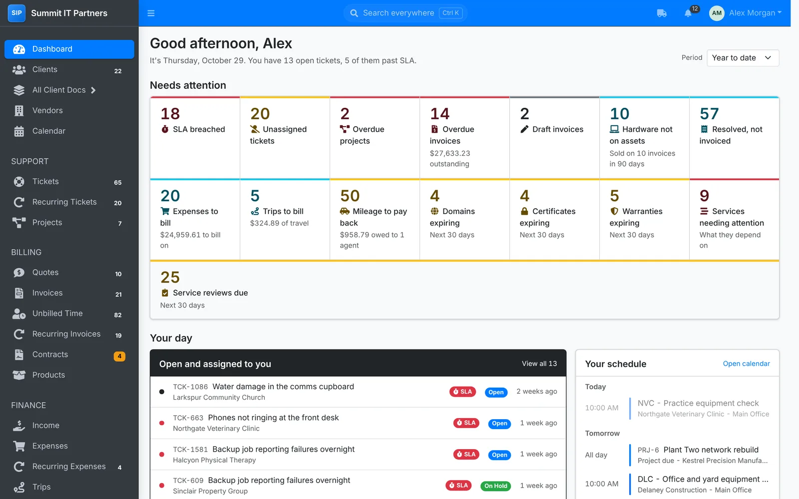
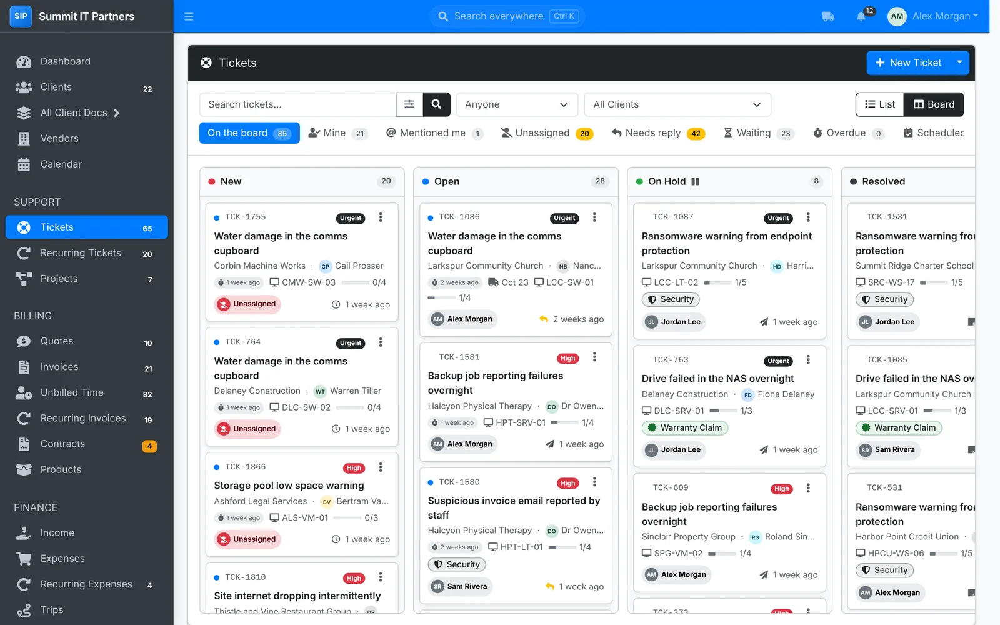
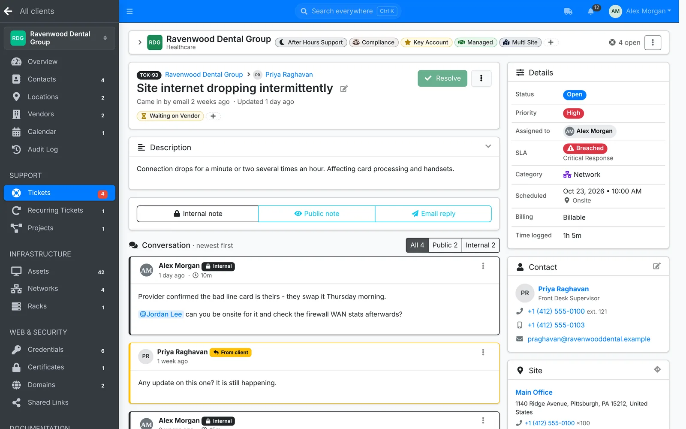
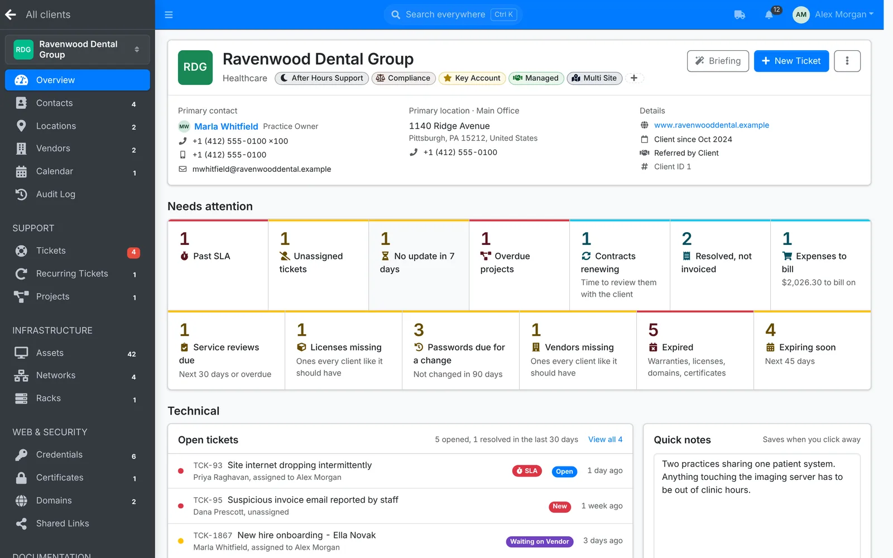
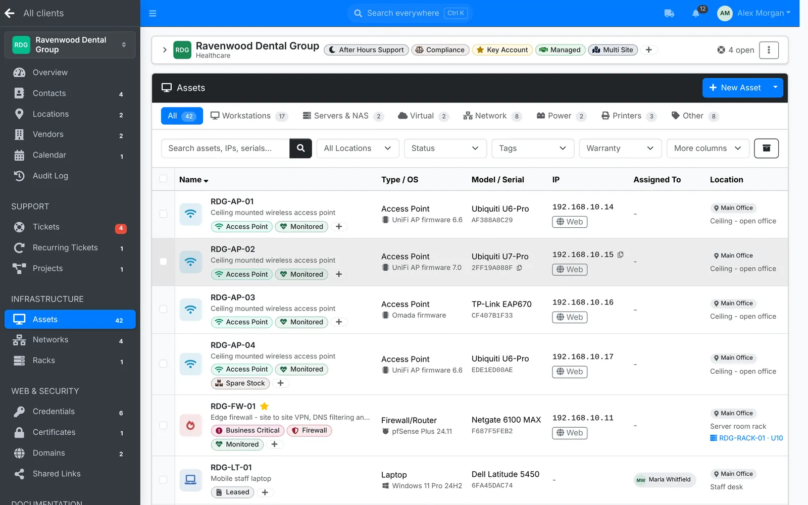
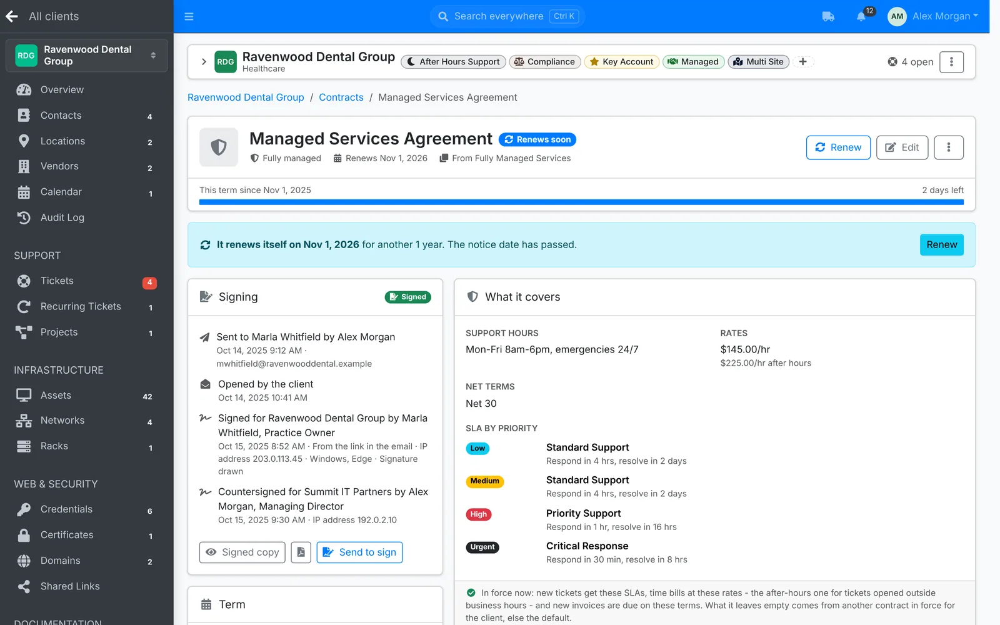
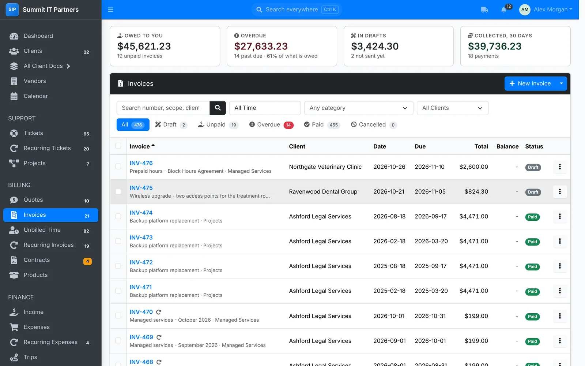
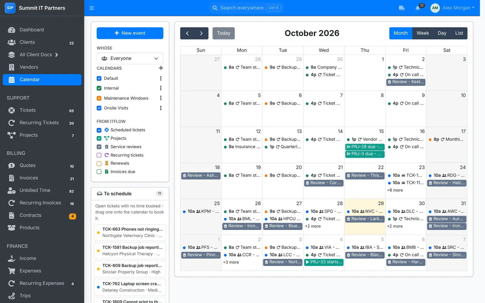
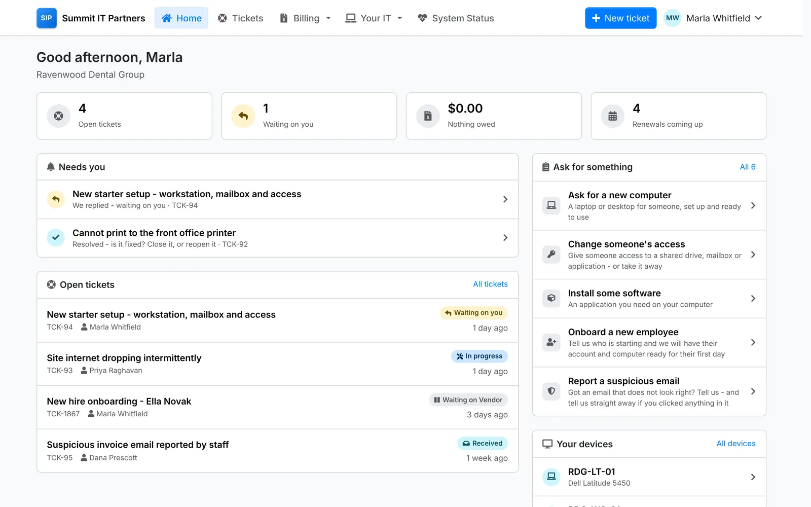

<div id="top"></div>

<div align="center">

<a href="https://itflow.org">
  <picture>
    <source media="(prefers-color-scheme: dark)" srcset=".github/readme/logo-dark.svg">
    
  </picture>
</a>

### The free, open-source PSA for MSPs

Ticketing, client documentation, contracts and billing - with a client portal - in one place that you host and control.

[![Release][release-shield]][release-url]
[![Stargazers][stars-shield]][stars-url]
[![Contributors][contributors-shield]][contributors-url]
[![Commits][commit-shield]][commit-url]
[![GPL License][license-shield]][license-url]

[**Live demo**](https://demo.itflow.org) &nbsp;·&nbsp; [Website](https://itflow.org) &nbsp;·&nbsp; [Docs](https://docs.itflow.org) &nbsp;·&nbsp; [Forum](https://forum.itflow.org) &nbsp;·&nbsp; [What's new](CHANGELOG.md)

Demo sign in: `demo@demo.com` / `demo`

</div>

<br>

<picture>
  <source media="(prefers-color-scheme: dark)" srcset=".github/readme/dashboard-dark.webp">
  
</picture>

## Why ITFlow

Small and growing MSPs juggle a lot: tickets coming in from every direction, client information scattered across spreadsheets and old notes, contracts nobody can find, and billing that eats into evenings. The usual answer is a stack of subscriptions that costs more every year.

ITFlow brings the core of running an MSP into one app: the service desk, everything you know about each client's IT, the agreements you look after them on, and the invoicing that pays for it all - plus a portal where clients raise tickets, pay invoices and look up their own IT. It's free, it's open source, and it runs on your own server, so your clients' data stays with you.

## New in 26.11

26.11 is the biggest release yet - nearly every page has been rebuilt. Highlights:

- **Contracts** - every agreement with a client, sent to sign online and countersigned in ITFlow, with prepaid hours and the SLAs, rates and payment terms that apply while it's in force
- **Client onboarding** - take a new client on a step at a time, from their sites and people to their agreement, billing, domains and kickoff project
- **A new client portal** - a fresh look, requests clients can raise in a click, online payments and autopay, their devices and licenses, and contracts to sign
- **Rebuilt service desk** - list and board views, SLA timers with business hours, canned responses, ticket templates and @mentions in internal notes
- **Everywhere** - search everything with <kbd>Ctrl</kbd>+<kbd>K</kbd>, a dashboard that shows what needs attention, and dark mode throughout
- **Your team** - invite agents by email, set what each role can open and which clients each agent sees, and keep an audit log of every change

See the [changelog](CHANGELOG.md) for everything in this release, and back up before you update.

## Features

<table>
  <tr>
    <td width="50%" valign="top">
      
      <br><b>Tickets</b> - a list or a board, with SLA timers, views for whose move it is, and schedules for onsite visits.
    </td>
    <td width="50%" valign="top">
      
      <br><b>Working a ticket</b> - reply by email or note, @mention a colleague, log time, work through tasks and book a visit.
    </td>
  </tr>
  <tr>
    <td width="50%" valign="top">
      
      <br><b>Client overview</b> - what needs attention, their contacts and sites, open tickets and the contract they're on.
    </td>
    <td width="50%" valign="top">
      
      <br><b>Assets</b> - every device you look after, with its details, network, warranty and who uses it.
    </td>
  </tr>
  <tr>
    <td width="50%" valign="top">
      
      <br><b>Contracts</b> - terms, renewals and notice dates, signing, prepaid hours and what each contract covers.
    </td>
    <td width="50%" valign="top">
      
      <br><b>Billing</b> - quotes, invoices and recurring invoices, unbilled time, payments and reminders.
    </td>
  </tr>
  <tr>
    <td width="50%" valign="top">
      
      <br><b>Calendar</b> - booked tickets, project dates, service reviews and renewals, on your phone too.
    </td>
    <td width="50%" valign="top">
      
      <br><b>Client portal</b> - clients raise tickets and requests, pay invoices and look up their own IT.
    </td>
  </tr>
</table>

### Service desk
- Tickets by email, from the client portal or raised by you, from scratch or from a template
- SLAs per priority with business hours and closure days, and views for whose move it is
- Recurring tickets for routine work, projects with due dates and hour budgets, and canned responses
- A shared calendar that agents can subscribe to on their phone or in Outlook

### Client documentation
- Assets, contacts, locations, vendors, licenses, domains and services for every client
- Client logins with encrypted usernames and passwords, 2FA codes, and every look at a password recorded
- SSL/TLS certificates and domains checked daily, with expiry warnings
- Networks with an IP address plan, racks drawn to scale, and documents and files with versions and templates
- Expiring share links for logins, documents and secure notes

### Contracts and billing
- Contracts with online signing, renewals, notice reminders and prepaid hours drawn down by ticket time
- Quotes clients accept online, invoices they pay online by card through Stripe, and recurring invoices that bill per user, device or license seat
- Unbilled time, expenses and trips turned into invoices in a few clicks
- Payment reminders, late fees and monthly statements
- Expenses, income, accounts, bank statement import and reconciliation, and reports from profit and loss to SLA performance

### Client portal
- Clients raise tickets and requests, follow them and approve tasks
- Billing contacts see their invoices, pay by card, save a card for autopay, accept quotes and sign contracts
- Technical contacts look up their devices, licenses, domains, certificates and shared documents
- Invite people by email, or let a client's staff sign up with their company email address

### Built for your team
- Roles that set what each agent can open, and limits on which clients they can see
- Two-factor sign in, agent invites and an audit log of every change
- A REST API, optional AI help with replies and summaries using the provider of your choice, encrypted backups and one-click updates

## Get started

### Self hosting

ITFlow is a PHP web app with a MariaDB database. You run it on your own Linux server: a small VM with 2 CPU cores and 2 GB of memory is plenty for most MSPs.

| Part | What it needs |
|---|---|
| **Server** | Linux - Debian 13 for the install script; Debian 12 or Ubuntu 24.04 by hand |
| **PHP** | 8.2 or later, with mysqli, intl, curl, mbstring, gd, xml, openssl and fileinfo |
| **Database** | MariaDB or MySQL |
| **Web server** | Apache with mod_php, or nginx with PHP-FPM |
| **Also** | git (ITFlow updates itself with it), a cron entry that runs every minute, and a domain name with HTTPS |

The quickest way in is the [install script](https://github.com/itflow-org/itflow-install-script). On a fresh Debian 13 server, run it as root and answer four questions. It sets up Apache, MariaDB and PHP, gets a Let's Encrypt certificate, and leaves you at the setup wizard:

```bash
wget -O itflow_install.sh https://github.com/itflow-org/itflow-install-script/raw/main/itflow_install.sh
bash itflow_install.sh
```

To install by hand, on a server you already run, or with a control panel, see the [docs](https://docs.itflow.org).

### Updating

Go to **Admin > Update** and click **Queue Update** - cron picks it up within a minute. Or run the updater from the command line, as the user that owns ITFlow's files:

```bash
sudo -u www-data php scripts/update_cli.php
```

Either way, ITFlow updates its files to the latest release and then applies the database changes. Read the [changelog](CHANGELOG.md) and take a backup first.

### Managed hosting

If you'd rather not run a server, we can [host ITFlow for you](https://itflow.org/hosting.php) (coming soon).

## Community and support

- **Help and discussion** - the community [forum](https://forum.itflow.org) is the place for questions, ideas and general discussion.
- **Bugs** - report them on the forum under [Bugs](https://forum.itflow.org/t/bug).
- **Feature ideas** - suggest them under [Features](https://forum.itflow.org/t/features). Confirmed work is tracked on [TaskFlow](https://tasks.dev.itflow.org/tasks.php).

### Contributing

We have temporarily paused pull requests from the community. See [CONTRIBUTING.md](CONTRIBUTING.md).

<a href="https://github.com/itflow-org/itflow/graphs/contributors">
  
</a>

### Supporters

We're incredibly grateful to the organizations and individuals who [sponsor](https://services.itflow.org) the project - a big thank you to:

- CompuMatter
- F1 for HELP
- digiBandit

## Security

ITFlow has had stable releases since January 2025. We take security reports seriously, but no system is risk-free - use your best judgement before storing highly confidential information in it.

If you find a security issue, please report it privately through our [security policy](https://github.com/itflow-org/itflow/security/policy) rather than in a public issue or on the forum.

## License

ITFlow is distributed "as is" under the GPL-3.0 license, WITHOUT WARRANTY OF ANY KIND. See [`LICENSE`](LICENSE) for details.

<p align="right"><a href="#top">Back to top</a></p>

<!-- MARKDOWN LINKS & IMAGES -->
[release-shield]: https://img.shields.io/github/v/release/itflow-org/itflow?style=for-the-badge
[release-url]: https://github.com/itflow-org/itflow/releases
[contributors-shield]: https://img.shields.io/github/contributors/itflow-org/itflow.svg?style=for-the-badge
[contributors-url]: https://github.com/itflow-org/itflow/graphs/contributors
[stars-shield]: https://img.shields.io/github/stars/itflow-org/itflow.svg?style=for-the-badge
[stars-url]: https://github.com/itflow-org/itflow/stargazers
[license-shield]: https://img.shields.io/github/license/itflow-org/itflow.svg?style=for-the-badge
[license-url]: https://github.com/itflow-org/itflow/blob/master/LICENSE
[commit-shield]: https://img.shields.io/github/last-commit/itflow-org/itflow?style=for-the-badge
[commit-url]: https://github.com/itflow-org/itflow/commits/master
